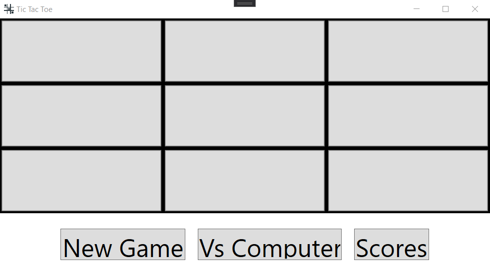

# ❌⭕ Tic Tac Toe

Desktop igra Iks-oks (Tic Tac Toe) za dva igrača ili protiv računara. Aplikacija bilježi rezultate (pobjede igrača X, pobjede igrača O i neriješene partije) tokom sesije. Rađena je u C# kao WPF aplikacija u okruženju Visual Studio.



---

## 🛠️ Tehnologije

| Sloj                  | Tehnologija                       |
|-----------------------|-----------------------------------|
| Jezik                 | C#                                |
| GUI                   | WPF (XAML)                        |
| Platforma             | .NET 5 (`net5.0-windows`)         |
| Razvojno okruženje    | Visual Studio                     |

---

## 📁 Struktura projekta

```
tic-tac-toe/
├── TicTacToe/
│   ├── App.xaml                  # Ulazna tačka aplikacije
│   ├── App.xaml.cs
│   ├── MainWindow.xaml           # Izgled glavnog prozora (tabla i dugmad)
│   ├── MainWindow.xaml.cs        # Logika interfejsa (klikovi, potez računara)
│   ├── TicTacToeGame.cs          # Logika igre (tabla, pobjednik, rezultati)
│   ├── Position.cs               # Pozicija polja na tabli
│   ├── AssemblyInfo.cs
│   ├── tac_tic_toe_icon.ico      # Ikonica aplikacije
│   └── TicTacToe.csproj          # Projektni fajl
└── TicTacToe.pdf                 # Korisničko uputstvo
```

---

## ✨ Funkcionalnosti

- **Igra za dva igrača:** igrači naizmjenično postavljaju X i O na tablu 3×3.
- **Igra protiv računara:** dugme *Vs Computer* uključuje igru protiv računara, koji igra sa O i bira nasumično slobodno polje. Ponovnim klikom dugme postaje *Vs Player* i vraća se igra za dva igrača.
- **Prepoznavanje ishoda:** igra otkriva pobjedu horizontalno, vertikalno i dijagonalno, kao i neriješen rezultat, te prikazuje poruku na ekranu.
- **Rezultati:** dugme *Scores* prikazuje broj pobjeda igrača X, igrača O i neriješenih partija.
- **Nova igra:** dugme *New Game* čisti tablu i počinje novu partiju.

---

## 🎮 Uputstvo za igranje

1. Kliknite na dugme **New Game** za početak nove igre.
2. Cilj igre je imati tri X ili tri O u jednoj liniji, horizontalno, vertikalno ili dijagonalno.
3. Za igranje protiv računara kliknite na dugme **Vs Computer**. Za povratak na igru dva igrača kliknite na isto dugme, koje se sada zove **Vs Player**.
4. Za prikaz rezultata kliknite na dugme **Scores**.

Detaljnije uputstvo nalazi se u dokumentu `TicTacToe.pdf`.

---

## 🚀 Pokretanje projekta

### Preduslovi

- Windows
- Visual Studio s podrškom za WPF (**.NET desktop development**)
- .NET 5 SDK (projekat cilja `net5.0-windows`)

### Koraci

1. Klonirati repozitorijum.
2. Otvoriti rješenje (`.sln`) ili projekat `TicTacToe.csproj` u Visual Studiju.
3. Pokrenuti aplikaciju (`F5`).
